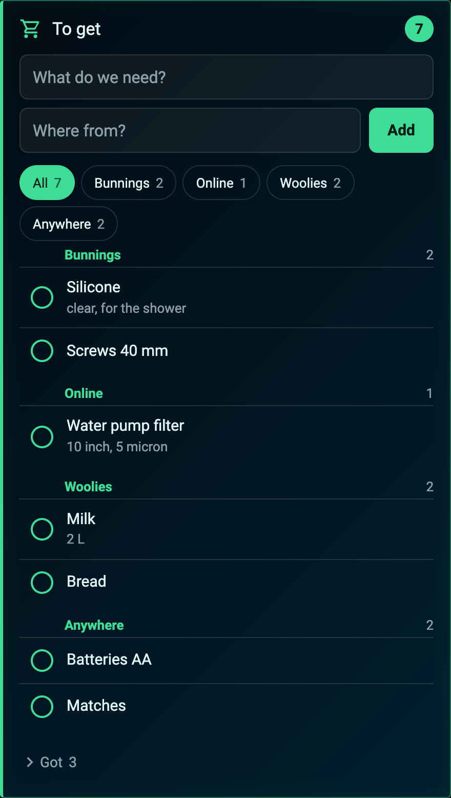
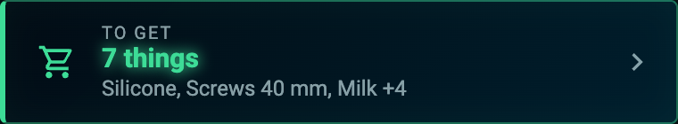
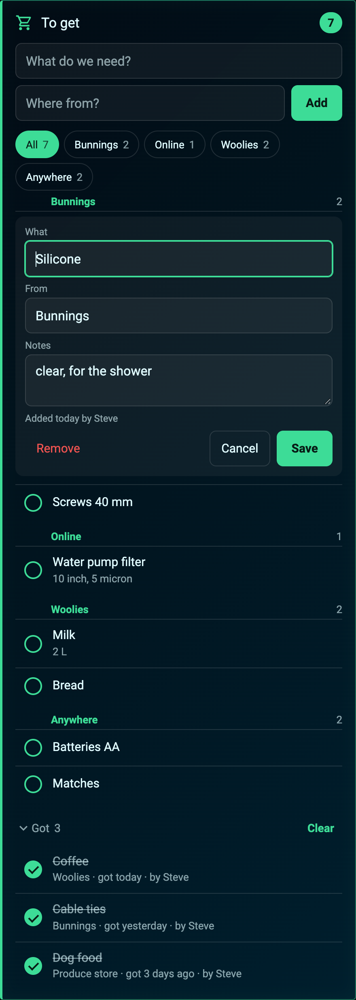
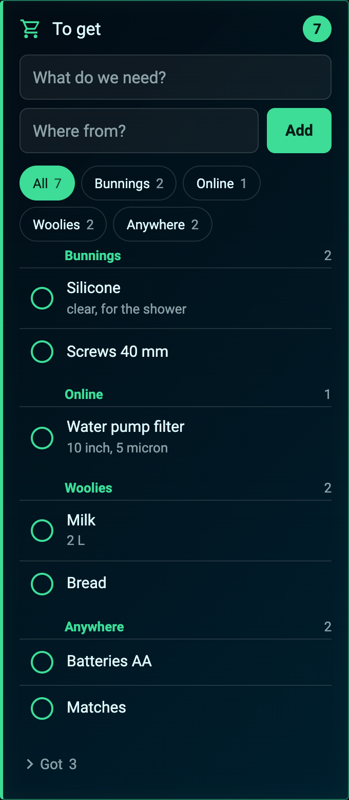

# To Get - a list of things to buy, get or order, for Home Assistant

A list of things the house needs, and where each one is coming from: the hardware store, the supermarket,
online, a neighbour. Add something when you think of it, see it all by place when you're out, and tick things
off as you get them. Everything is stored in your own Home Assistant.





The screenshots use made-up data.

## Features

- **Add it when you think of it.** Type what's needed and, if you like, where it's coming from.
- **By place.** Things are grouped under the place they're coming from, and a tap on a place shows only
  that place's things, for when you're there. Things with no place sit under Anywhere.
- **It remembers.** Something that's been on the list before comes back with the place it came from last
  time, and the boxes suggest things and places you've used.
- **No doubles.** Adding something that's already on the list points it out instead.
- **Tick things off**, with an undo. What's been got is kept, folded away, until you clear it.
- **A count strip** for any dashboard: how many things there are to get and the first few, linking to the list.
- **A real to-do list.** Each list is a Home Assistant to-do entity, so it's in the To-do panel and the
  companion app, Assist can add to it ("add milk to the To get list"), and its state is how many things are
  still to get.
- **Stays in step.** Tick something off on one phone and every open card updates.
- **More than one list** if you want them: groceries, hardware, online orders.
- **Follows your theme**, light or dark.

## Installation

### Requirements

Home Assistant 2025.12 or newer.

### HACS

1. In HACS, open the menu (top right) and choose **Custom repositories**.
2. Add `https://github.com/ClermontDigital/ToGet` with the type **Integration**.
3. Find **To Get** in HACS, download it, and restart Home Assistant.

### Manual

Copy `custom_components/to_get` into your Home Assistant `config/custom_components` folder and restart.

### Adding a list

Go to **Settings > Devices & services > Add integration** and choose **To Get**. The first list is called
To get unless you give it another name. Add the integration again for each other list. The icon can be changed
later under the list's **Configure** button.

### The card

The card is installed with the integration. Edit a dashboard, choose **Add card** and search for **To Get**,
or add it in YAML:

```yaml
type: custom:to-get-card
```

| Option | Default | What it does |
|---|---|---|
| `entry_id` | your first list | Which list to show. Pick it from the list in the card editor. |
| `view` | `full` | `full` is the list. `count` is one strip: how many things there are to get and the first few. |
| `title` | the list's name | A different heading. |
| `icon` | the list's icon | A different icon. |
| `hide_title` | `false` | Leave the heading out, for when the card sits under a heading of its own. |
| `hide_got` | `false` | Leave out what's been got (it's folded away under the list otherwise). |
| `navigation_path` | | For the strip: where a tap goes, usually the dashboard the list is on, such as `/lovelace/lists`. |

With no `entry_id`, the strip counts every list.

On the list, type what's needed in the first box and where it's coming from in the second, then press Enter or
**Add**. Leave the place empty and something that's been on the list before takes the place it came from last
time (the box shows which). While one place is picked, new things go to that place. Tap the circle to tick
something off, and tap its name to change it, add notes, or remove it.

<p>
  
  
</p>

The accent colour can be changed in a theme with `to-get-accent`, or on the card with card-mod by setting
`--tg-accent` on `ha-card`. The strip also takes `--tg-glow` (a text shadow on the count), `--tg-name-size`,
`--tg-name-transform` and `--tg-name-spacing` (for its small title).

If the card doesn't appear after installing, refresh the browser. On a dashboard managed in YAML, add
`/to_get/to-get-card.js` as a JavaScript module resource.

## The to-do entity

Each list is a device with one to-do entity, `todo.to_get` for a list called To get. Its state is how many
things are still to get. Home Assistant's own to-do actions (`todo.add_item`, `todo.update_item`,
`todo.remove_item`, `todo.remove_completed_items`, `todo.get_items`) work on it, and a thing's notes are its
to-do description. The place is To Get's own: it shows on the card, and `to_get.add` sets it.

## Actions

`to_get.add` puts something on a list, with where it's coming from. Something already on the list isn't added
twice. Leave `place` out and it's the place the thing came from last time, if it's been on the list before.

```yaml
action: to_get.add
target:
  entity_id: todo.to_get
data:
  item: Silicone
  place: Bunnings
  notes: Clear, for the shower
```

## Automation ideas

Put toilet paper on the list when [Stock Track](https://github.com/ClermontDigital/StockTrack) says it's
running low:

```yaml
triggers:
  - trigger: state
    entity_id: binary_sensor.toilet_paper_running_low
    to: "on"
actions:
  - action: to_get.add
    target:
      entity_id: todo.to_get
    data:
      item: Toilet paper
```

A reminder when you get to a shop with things to get there: use a zone for the shop and
`todo.get_items`, or simply the list's state:

```yaml
triggers:
  - trigger: zone
    entity_id: person.you
    zone: zone.town
    event: enter
conditions:
  - condition: numeric_state
    entity_id: todo.to_get
    above: 0
actions:
  - action: notify.mobile_app_your_phone
    data:
      message: "{{ states('todo.to_get') }} things to get while you're in town."
```

## How it works

- Things are the same however they're typed: "milk", "Milk" and " MILK " are one thing.
- **Adding** something already on the list doesn't add it again; a place or notes given with it are kept.
  Adding something that's been got before puts that one back on the list, at the end, with its place and notes
  unless new ones are given.
- **Places are remembered** per thing, from when it's added or changed. A thing added with no place takes the
  remembered one; an empty place given on purpose means none.
- **Renaming** a thing (fixing a typo, say) stops the old name being suggested. A thing can't be renamed to, or
  put back as, something that's already on the list.
- Ticking something off from Assist ("mark milk as done") keeps its notes.
- A list holds up to 500 things to get. The 200 most recently got are kept until cleared, and 300 things are
  remembered.

## Your data

Each list is a small file in Home Assistant's `.storage` folder (`to_get.<id>`), so it's included in your Home
Assistant backups. Nothing is sent anywhere. Deleting a list from **Devices & services** deletes it.

Anyone signed in to your Home Assistant can view a list, as they can any to-do list. Changing it needs the same
permission as changing its to-do entity, so a read-only user can look but not change anything.

## WebSocket API

The card talks to the integration over Home Assistant's WebSocket connection. `entry_id` is the list's config
entry id.

| Command | Fields | Returns |
|---|---|---|
| `to_get/lists` | | Each list's `entry_id`, `name`, `icon`, `count` and `first` (the first few things) |
| `to_get/subscribe` | `entry_id` | The list now and after every change: `items`, `got`, `places`, `names` and `can_change`. `{"gone": true}` while it isn't set up. |
| `to_get/subscribe_summary` | `entry_id` (optional) | How many things are to get on each list (or one), now and after every change |
| `to_get/add` | `entry_id`, `summary`, `place` (optional), `notes` (optional) | The `item`, and `how`: `added`, `reopened` or `already` |
| `to_get/update` | `entry_id`, `uid`, `summary`, `place`, `notes`, `done` (all but the first two optional) | The item |
| `to_get/remove` | `entry_id`, `uids` | How many were removed |
| `to_get/clear` | `entry_id` | How many got things were removed |

## Development

```bash
python -m venv .venv && . .venv/bin/activate
pip install -r requirements_test.txt
pytest
```

`custom_components/to_get/store.py` holds the list's rules. The card is one plain JavaScript file with no build
step: `custom_components/to_get/www/to-get-card.js`.

The card has its own checks, run in headless Chrome against the real API handlers and list rules with made-up
data. They also retake the screenshots in `images/`.

```bash
npm install --no-save puppeteer-core
node tests/card/drive.cjs
```

Set `CHROME` to your Chrome or Chromium if it isn't in the default macOS location, and `SHOTS=0` to leave the
screenshots alone. To look at the card by hand, run `python tests/card/server.py` and open
`http://127.0.0.1:8799/`.

## Issues and contributions

Bug reports and ideas are welcome in [Issues](https://github.com/ClermontDigital/ToGet/issues). Pull requests
are welcome too; please include a test for anything in `store.py` or the API.

## License

[Apache License 2.0](LICENSE)
